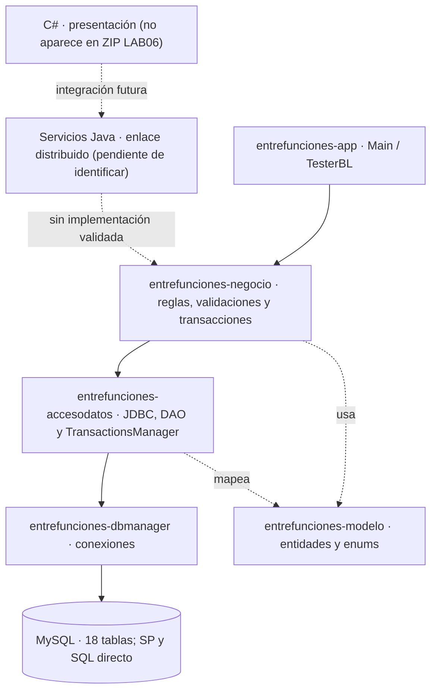

# EntreFunciones — Mapa técnico vivo

**Propósito:** entender el sistema y mantener la documentación junto a su código, no duplicar informes ni crear otra base manual.

> **Base de esta revisión:** `entrefunciones.zip` entregado para LAB06, guardado el 30-09-2026. Este mapa es una **fotografía de esa entrega**, NO una verificación del estado actual de `main`. Después de integrar los cambios posteriores, actualizar fecha, código de referencia y diferencias.

## Mapa de la implementación Java identificada

**Comprobado leyendo archivos:** hay 5 módulos Maven hijos (modelo, dbmanager, accesodatos, negocio y app). El `pom.xml` de `negocio` depende de `accesodatos` y el de `accesodatos` depende de `modelo` y `dbmanager`. Los servicios Java/C# todavía **no están en el ZIP inspeccionado**; no se afirma que no existan en otras ramas.

## Abrir lo que necesitas

| Quiero entender… | Voy a… |
| --- | --- |
| Qué SP existen y qué DAO los nombra | [Catálogo de SP](catalogo-sp.md) |
| Qué versión se presentó y qué feedback recibió | [Entregas](entregas.md) y [LAB06](entregas/LAB06/README.md) |
| Código de los SP | [`entrefunciones/sql/procedimientos.sql`](../entrefunciones/sql/procedimientos.sql) |
| Tablas y relaciones | [`entrefunciones/sql/entrefunciones-mysql.sql`](../entrefunciones/sql/entrefunciones-mysql.sql) |
| Operaciones de negocio | [`entrefunciones/entrefunciones-negocio`](../entrefunciones/entrefunciones-negocio) |
| Código DAO | [`entrefunciones/entrefunciones-accesodatos`](../entrefunciones/entrefunciones-accesodatos) |

## Estado de verificación

| Pregunta | Situación al documentar LAB06 |
| --- | --- |
| ¿Existe modelo, DAO, BL y acceso a MySQL? | Archivos presentes; ejecución no verificada por esta auditoría |
| ¿Cuántos SP declara el SQL? | 73 declaraciones `CREATE PROCEDURE` |
| ¿Hay SP identificables desde Java? | 72 de 73 nombres aparecen literalmente en archivos `*DAOImpl.java`; no prueba ejecución |
| ¿Está enlazado Java con C#? | No comprobado en el ZIP entregado |
| ¿Funciona `mvnw.cmd clean verify`? | Pendiente de ejecución local |
| ¿Se comprobó rollback ante fallo? | Pendiente de pruebas reproducibles |

## Cómo impedir que este documento quede abandonado

Cada Pull Request que cambie la estructura, el SQL o un flujo principal debe **actualizar este mapa o indicar por qué no necesita cambios**. El código es la fuente de verdad: si el documento discrepa, se corrige el documento. Mantén el mapa corto; el detalle de un método vive en el código, no repetido aquí.

Al abrir la carpeta `docs/` como bóveda de Obsidian puedes ver y editar estos mismos Markdown; Git versiona los cambios. Los diagramas Mermaid se ven también en GitHub.
